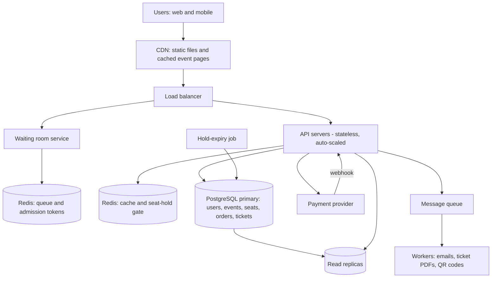

# TicketHub: System Design

TicketHub is a website that sells tickets for concerts and events. This document follows the six-part framework: requirements, estimates, API, data model, architecture, trade-offs. It also explains, in its own section, how two people can never buy the same seat.

**Given facts**

- 2 million registered users
- Normal day: 50,000 visitors, 10 pages each, 5,000 tickets sold
- Big sale: 200,000 people try to buy 20,000 seats in the first 10 minutes

---

## 1. Requirements

### Functional requirements

1. Users can register, log in and log out.
2. Users can browse and search events (by artist, city, date) and open an event page.
3. Users can see a seat map for an event showing which seats are available, held or sold.
4. Users can select seats and **hold** them for a short time (10 minutes) while they pay.
5. Users can pay for held seats and receive an order confirmation.
6. Users can view their purchased tickets, each with a unique ticket code (QR code).
7. Held seats that are not paid for are released automatically when the hold expires.
8. Users can cancel a hold before paying.
9. Organizers can create events and set seat prices (out of scope for this document beyond the data model).

### Non-functional requirements

| Quality | Requirement | Why it matters |
|---|---|---|
| **Correctness** (most important) | A seat is sold to **at most one** person, always, even under heavy concurrency. A user is never charged for a seat they do not get. Every paid order results in exactly one ticket per seat. | Double-selling a seat means two angry customers and a refund. Correctness beats speed. |
| **Speed** | Browsing pages: p95 under 300 ms. Seat map: p95 under 500 ms. Holding seats: p95 under 500 ms, even during the big sale. | Users who wait leave, and in a big sale they refresh repeatedly, which adds more load. |
| **Fairness** | First come, first served: people who arrived earlier get a chance earlier. A per-user limit (6 tickets per event) and bot protection stop one person or script from taking most seats. | The big sale is a competition. If it feels rigged, users lose trust. |
| **Availability** | The site stays up during the big sale. If part of the system fails, browsing still works. Target 99.9% monthly. | A crash on sale day is the worst possible time. |
| **Scalability** | Handles roughly 1,000 times the normal request rate for short bursts, without paying for that capacity all year. | See estimates below. |
| **Durability** | A confirmed order is never lost (data replicated, backups). | Payment has already happened. |
| **Security** | Passwords hashed, HTTPS everywhere, card data handled only by the payment provider. | Legal and trust requirements. |

---

## 2. Estimates

### Normal day

- **Page views:** 50,000 visitors × 10 pages = **500,000 page views/day**.
- **Average rate:** 500,000 / 86,400 s ≈ **6 requests/second**.
- **Normal peak:** traffic is not flat; assume the busiest hour is about 10× the average, so **about 60 requests/second**.
- **Ticket sales:** 5,000 tickets/day / 86,400 s ≈ **0.06 tickets/second** on average, and under 1 per second at peak. Writes are tiny.
- **Storage:** 5,000 tickets/day × 365 ≈ 1.8 million tickets per year. At roughly 200 bytes per row, about **0.4 GB per year**. Users: 2 million × ~1 KB ≈ 2 GB. Seats for one 20,000-seat event is 20,000 rows, which is small.

A single modest database and a couple of web servers handle this easily.

### Big sale (one very popular concert)

- 200,000 people in 10 minutes (600 seconds).
- **Assumption:** each person loads the page, refreshes the seat map several times, and attempts holds, about **20 requests each** over the 10 minutes.
- **Average rate:** 200,000 × 20 / 600 ≈ **6,700 requests/second**.
- **Burst:** most people arrive in the first seconds, so assume 5× the average for the first 30 seconds: **about 30,000 requests/second**.
- **Hold attempts:** if each person tries about 3 seats, that is 600,000 attempts / 600 s ≈ **1,000 holds/second**, with bursts of around 5,000/second.
- **Successful sales:** at most 20,000 in 10 minutes ≈ **33 sales/second**.
- **Contention:** 200,000 people for 20,000 seats means about **10 people per seat**. At least 90% of buyers will lose, and many will fight for the same "best" seats.

### Comparison

| Metric | Normal day | Big sale | Ratio |
|---|---|---|---|
| Request rate (average) | ~6/s | ~6,700/s | **~1,100×** |
| Request rate (peak) | ~60/s | ~30,000/s | **~500×** |
| Write attempts (holds / purchases) | ~0.06/s | ~1,000/s | **> 10,000×** |
| Tickets sold | 5,000 in 24 hours | 20,000 in 10 minutes | **4× a whole normal day, in 0.7% of the time** |

**Conclusion:** the big sale is a different problem, not a bigger version of the normal one. The danger is not total volume (it lasts only 10 minutes) but the **spike** and the **contention on the same rows**. We cannot buy hardware for 30,000 requests/second all year, and the database cannot take 30,000 writes/second on hot rows. The design must (1) serve most traffic from caches and a CDN, (2) limit how many people reach the database at once, and (3) rely on the database only for the small set of operations that must be correct.

---

## 3. API

REST over HTTPS, JSON. All endpoints except browsing require `Authorization: Bearer <token>`.

| # | Endpoint | Purpose |
|---|---|---|
| 1 | `GET /events?city=&date=&q=&page=` | Browse and search events. Cacheable (CDN). |
| 2 | `GET /events/{eventId}` | Event details (artist, venue, date, price ranges, sale status). Cacheable. |
| 3 | `GET /events/{eventId}/seats` | Seat map: each seat with `status` (`available`, `held`, `sold`). Cached for 1–2 seconds; **informational only**. |
| 4 | `POST /events/{eventId}/queue` | Join the waiting room for a big sale. Returns a queue position and, when admitted, an access token. |
| 5 | `POST /events/{eventId}/holds` | Hold seats. Body: `{ "seatIds": ["A12","A13"] }`. Returns `201` with `holdId` and `expiresAt`, or `409` if any seat is taken. All-or-nothing. |
| 6 | `DELETE /holds/{holdId}` | Release a hold early. |
| 7 | `POST /orders` | Create an order from a hold. Header `Idempotency-Key` required. Body: `{ "holdId": "..." }`. Returns `orderId`, total, status `pending_payment`. |
| 8 | `POST /orders/{orderId}/payments` | Pay for the order. Body: payment method token from the payment provider. Header `Idempotency-Key` required. On success the order becomes `paid` and tickets are issued. |
| 9 | `GET /me/orders` | List my orders. |
| 10 | `GET /me/tickets` | View my tickets, with ticket codes. |

**Example: hold seats**

```
POST /events/42/holds
{ "seatIds": ["A12", "A13"] }

201 Created
{ "holdId": "h_9f3", "seatIds": ["A12","A13"], "expiresAt": "2026-11-20T19:10:00Z" }

409 Conflict
{ "error": "SEAT_UNAVAILABLE", "seatIds": ["A13"] }
```

**Design notes**

- Holding and paying are separate steps because payment takes time. A hold gives the user a fair window without blocking the seat forever.
- `Idempotency-Key` makes retries safe: if the user's phone resends the payment request, they are not charged twice.
- The seat map (endpoint 3) can be slightly out of date. It is a hint. Only the hold endpoint decides who gets a seat.

---

## 4. Data model

PostgreSQL (relational, with transactions and constraints).

```
users 1 ──< orders 1 ──< tickets >── 1 seats >── 1 events 1 ──< ... 
users 1 ──< holds   (a hold is stored on the seat rows it covers)
orders 1 ──< payments
```

### Tables

**users**

| column | type | notes |
|---|---|---|
| id | bigint PK | |
| email | text | **UNIQUE**, NOT NULL |
| password_hash | text | NOT NULL |
| name | text | |
| created_at | timestamptz | |

**events**

| column | type | notes |
|---|---|---|
| id | bigint PK | |
| name | text | NOT NULL |
| venue | text | |
| city | text | indexed |
| starts_at | timestamptz | indexed |
| sale_starts_at | timestamptz | when tickets go on sale |
| max_tickets_per_user | int | default 6 |
| created_at | timestamptz | |

**seats** (one row per seat per event)

| column | type | notes |
|---|---|---|
| id | bigint PK | |
| event_id | bigint FK → events.id | NOT NULL |
| section, row_label, seat_number | text | |
| price_cents | int | CHECK (price_cents >= 0) |
| status | text | `available`, `held`, `sold`. CHECK status IN (...) |
| held_by | bigint FK → users.id | NULL unless held |
| hold_id | text | groups seats held together |
| hold_expires_at | timestamptz | NULL unless held |
| | | **UNIQUE (event_id, section, row_label, seat_number)** so a seat exists only once |

**orders**

| column | type | notes |
|---|---|---|
| id | bigint PK | |
| user_id | bigint FK → users.id | NOT NULL |
| event_id | bigint FK → events.id | NOT NULL |
| status | text | `pending_payment`, `paid`, `failed`, `cancelled` |
| total_cents | int | |
| idempotency_key | text | **UNIQUE (user_id, idempotency_key)** |
| created_at | timestamptz | |

**tickets** (one row per sold seat)

| column | type | notes |
|---|---|---|
| id | bigint PK | |
| order_id | bigint FK → orders.id | NOT NULL |
| seat_id | bigint FK → seats.id | NOT NULL, **UNIQUE** |
| ticket_code | text | **UNIQUE**, used for the QR code |
| issued_at | timestamptz | |

**payments**

| column | type | notes |
|---|---|---|
| id | bigint PK | |
| order_id | bigint FK → orders.id | |
| provider_ref | text | **UNIQUE**, the payment provider's transaction id |
| amount_cents | int | |
| status | text | `succeeded`, `failed` |

### Relationships

- A **user** has many **orders**; an **order** belongs to one user and one event.
- An **event** has many **seats** (about 20,000 for the big concert).
- An **order** has many **tickets**; each **ticket** is for exactly one **seat**, and a seat has at most one ticket (UNIQUE on `tickets.seat_id`).
- An **order** has one or more **payments** (a retry after a failed card creates a second payment row).

### Indexes

- `seats (event_id, status)` for the seat map.
- `seats (hold_expires_at) WHERE status = 'held'` for the expiry job.
- `events (city, starts_at)` for browsing.
- `orders (user_id, created_at)` and `tickets (order_id)` for "my tickets".

---

## 5. How double-booking is prevented

The failure we must prevent is a **race condition**:

1. Alice's request reads seat A12: `available`.
2. Bob's request reads seat A12: `available`.
3. Alice's request writes: A12 is hers.
4. Bob's request writes: A12 is his. **Two owners.**

The bug is that "check" and "write" are two separate steps. Anything that does `SELECT` then `UPDATE` in application code is unsafe. We use three layers, so that even a bug in one does not cause a double sale.

### Layer 1: one atomic conditional UPDATE (the hold)

The check and the write are a single SQL statement, inside a transaction:

```sql
BEGIN;

UPDATE seats
   SET status = 'held',
       held_by = :user_id,
       hold_id = :hold_id,
       hold_expires_at = now() + interval '10 minutes'
 WHERE id = ANY(:seat_ids)
   AND event_id = :event_id
   AND (status = 'available'
        OR (status = 'held' AND hold_expires_at < now()));   -- expired holds can be taken

-- If rows_updated != number of seats requested, ROLLBACK and return 409.
-- Otherwise COMMIT.
COMMIT;
```

PostgreSQL takes a **row lock** when an `UPDATE` touches a row. If Alice and Bob update A12 at the same moment, one waits for the other to commit. When Bob's statement resumes, it re-checks the `WHERE` clause against the committed row, sees `status = 'held'` with a future expiry, and updates **0 rows**. Bob gets `409`. The transaction also makes the hold **all-or-nothing**: if Bob wanted A12 and A13 and only A13 is free, he gets neither and nothing is left half-held.

To avoid **deadlocks** (Alice locks A12 then A13 while Bob locks A13 then A12), the seat ids are always sorted before the UPDATE, so every transaction locks rows in the same order.

### Layer 2: confirming the sale in a transaction

After payment succeeds, one transaction turns the hold into a sale:

```sql
BEGIN;

UPDATE seats
   SET status = 'sold'
 WHERE id = ANY(:seat_ids)
   AND status = 'held'
   AND held_by = :user_id
   AND hold_expires_at > now();   -- the hold must still be valid
-- rows_updated must equal the number of seats, otherwise ROLLBACK.

UPDATE orders SET status = 'paid' WHERE id = :order_id AND status = 'pending_payment';
INSERT INTO tickets (order_id, seat_id, ticket_code) VALUES ...;
INSERT INTO payments (...) VALUES (...);

COMMIT;
```

Seat, order, tickets and payment change together or not at all. A crash halfway leaves nothing half-done.

If the hold expired during payment and someone else took the seat, the `UPDATE` matches 0 rows, the transaction rolls back and the payment is **refunded automatically**. To make this rare, the payment page shows a countdown, and the order step re-checks the hold just before sending the user to the payment provider.

### Layer 3: constraints as the final safety net

- `tickets.seat_id` is **UNIQUE**. Even if a bug in our code tried to issue a second ticket for the same seat, PostgreSQL rejects the insert and the whole transaction rolls back.
- `seats` is **UNIQUE** on (event, section, row, number), so a seat cannot be duplicated as two rows.
- `CHECK` on `status` allows only valid values.
- `orders.idempotency_key` is **UNIQUE** per user, and `payments.provider_ref` is **UNIQUE**, so a retried request or a duplicate payment callback cannot create a second order or a second charge.

Constraints are enforced by the database for **every** writer (the API, an admin script, a background job), which is why they are the last line of defense.

### Releasing expired holds

A background job runs every 30 seconds:

```sql
UPDATE seats SET status = 'available', held_by = NULL, hold_id = NULL, hold_expires_at = NULL
 WHERE status = 'held' AND hold_expires_at < now();
```

Correctness does not depend on this job: Layer 1 already allows taking a seat whose hold has expired. The job only keeps the seat map accurate.

### Isolation level

`READ COMMITTED` (the PostgreSQL default) is enough, because the correctness comes from the atomic conditional UPDATE and the row lock, not from reading data and deciding in application code. `SERIALIZABLE` would also be correct but would cause many retries under big-sale contention.

### Protecting the database during the big sale

The database is correct under any load, but it is slow if 200,000 people fight for its locks. Two things reduce the pressure (see architecture): the **waiting room** limits how many users are active at once, and a **Redis gate** (`SET seat:{id} user NX EX 600`) rejects most losing hold attempts in memory before they reach PostgreSQL. Redis is only an optimization: if it is lost or wrong, the PostgreSQL statements above still prevent double-booking.

### Fairness

- The waiting room admits people in the order they joined (with a small random shuffle inside the first second, so a faster network connection does not win by milliseconds).
- A limit of 6 tickets per user per event is enforced in the hold transaction.
- Rate limits per user and per IP, plus a CAPTCHA at queue entry, reduce bots.

---

## 6. Architecture



### Components

| Component | What it does | Why it is there |
|---|---|---|
| **CDN** | Serves images, JavaScript and cached public pages (event lists, event details). | Most of the 30,000 requests/second are people looking at the same pages. The CDN answers them without touching our servers. |
| **Load balancer** | Spreads requests across API servers, checks their health, terminates HTTPS. | No single server is a bottleneck or a single point of failure. |
| **Waiting room service** | For events marked as "high demand", puts users in a queue and admits a fixed number at a time (for example 2,000 active shoppers, then more as people finish or time out). Admitted users get a signed token required for the hold endpoint. | Turns a 200,000-person spike into a steady flow the database can handle. It is also the fairness mechanism: the queue order. |
| **API servers** | Stateless application servers that implement the API. Auto-scale up before a big sale (scheduled, because we know the sale time). | Stateless means we can add or remove servers without losing anything. |
| **Redis (cache)** | Caches the seat map (1–2 s) and event data. | Seat map reads are the heaviest read load; 200,000 users polling it would overload the database. One cached copy serves everyone. |
| **Redis (hold gate and queue)** | Atomic `SET NX EX` per seat to reject obvious conflicts quickly; stores queue positions and admission tokens. | Rejects most of the ~90% losing hold attempts in microseconds. It is an optimization only; PostgreSQL stays the source of truth. |
| **PostgreSQL primary** | Stores everything that must be correct: seats, orders, tickets, payments. Runs the transactions from section 5. | ACID transactions and constraints prevent double-booking. All writes go here. |
| **Read replicas** | Serve browsing and "my tickets" reads. | Keep reads off the primary so it can focus on seat writes. Slight replication lag is acceptable for these reads, but never for holds. |
| **Payment provider** | Charges the card. We never see card numbers. | Security and compliance. A webhook confirms the result even if the user closes the browser. |
| **Message queue + workers** | After a sale, workers send confirmation emails and generate ticket PDFs/QR codes. | Slow work happens outside the request, so the sale step stays fast, and a spike of emails can be processed gradually. |
| **Hold-expiry job** | Releases expired holds every 30 seconds. | Keeps the seat map accurate and frees seats from abandoned carts. |

### How it survives the big sale

1. **Before the sale:** the event page and static assets are cached on the CDN. API servers are scaled up on a schedule. The waiting room opens 15–30 minutes early so people queue instead of refreshing.
2. **At the start:** 200,000 users hit the CDN and the waiting room, not the database. The waiting room is built on Redis and handles a very high request rate cheaply.
3. **Shopping:** only admitted users (about 2,000 at a time) can view the live seat map and request holds. The seat map comes from the Redis cache, so the database is not polled by thousands of clients.
4. **Holding:** the Redis gate rejects most conflicting attempts; the survivors run the atomic conditional UPDATE on PostgreSQL. The database now sees hundreds of writes per second, not tens of thousands.
5. **Paying:** the 10-minute hold protects the user's seats while they pay. Payment goes through the provider; the webhook finalizes the sale transaction.
6. **After the sale:** sold-out is reached, the waiting room tells remaining users "sold out" immediately, and failed or abandoned holds are released and re-sold.
7. **If something fails:** if Redis fails, requests fall back to PostgreSQL (slower but still correct). If a worker fails, the queue retries it. If the payment provider is slow, holds stay valid for their 10 minutes and users can retry safely thanks to idempotency keys.

---

## 7. Trade-offs

### Trade-off 1: Strong consistency for seats vs. speed and scale

- **Choice:** seat holds and sales always go through PostgreSQL with transactions and constraints, even though a single database primary limits write throughput.
- **Alternative:** a distributed, eventually consistent store (for example, sharded NoSQL with replicas) would scale writes further.
- **Why this choice:** correctness is the top requirement. Selling a seat twice is far worse than a slower hold. The write load is small enough (~33 successful sales/second, ≤ a few hundred hold attempts/second after the waiting room) for one well-tuned primary.
- **Cost:** the primary is a single write point and scaling it further would require sharding by event. We accept this and note that sharding by `event_id` is a natural future step.

### Trade-off 2: Cached seat map vs. accurate seat map

- **Choice:** the seat map is cached for 1–2 seconds in Redis.
- **Benefit:** it removes the largest read load from the database.
- **Cost:** users sometimes click a seat that already looks free but is taken, and get a `409`. This is a worse experience, but it is safe, because only the hold endpoint decides. We soften it by showing a friendly message and refreshing the map.

### Trade-off 3: Waiting room vs. user experience

- **Choice:** during big sales, users wait in a queue.
- **Benefit:** the system stays up and the order is fair, rather than the fastest connection or the most refreshes winning.
- **Cost:** some users wait for a long time and the extra component adds complexity. The alternative, letting everyone in, risks a crash or timeouts where nobody can buy.

### Trade-off 4: Hold duration (10 minutes)

- **Short hold (for example 3 minutes):** seats from abandoned carts return quickly, which is better for sales and for people still waiting. But slow payments or 3-D Secure steps may fail, which frustrates users.
- **Long hold (for example 20 minutes):** friendlier for buyers, but at a 10:1 demand ratio, abandoned holds block seats other people would have paid for.
- **Choice:** 10 minutes, with a visible countdown, as a middle ground. It can be tuned per event.

### Trade-off 5: Redis gate vs. simplicity

- **Choice:** add Redis in front of PostgreSQL for hold attempts.
- **Benefit:** protects the database from most losing requests.
- **Cost:** two systems must agree. We accept this because Redis is advisory: the database decides, so a stale Redis entry can at worst reject a request that could have succeeded (and expires on its own after 10 minutes).
